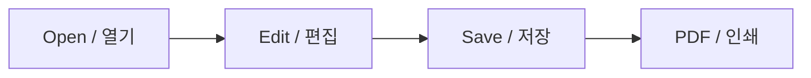

# Markdoc 테스트용 샘플 파일 / Markdown Test Sample

> **이 파일은 Markdown 편집기 기능을 확인하기 위한 테스트용 샘플 파일입니다.This file is a test sample for checking Markdown editor features.** 실제 안내 문서나 실행 지침이 아닙니다. 코드는 문법 표시를 확인하기 위한 예제입니다.

Markdown은 구현체마다 지원 범위가 다릅니다. 이 파일은 기본 문법과 널리 사용되는 확장 문법을 함께 담았으며, 모든 편집기가 모든 항목을 렌더링하는 것은 아닙니다. Markdoc에서 지원하지 않는 문법도 비교 테스트를 위해 포함합니다.

## 1\. 제목 / Headings

# Heading 1 — 제목 1

## Heading 2 — 제목 2

### Heading 3 — 제목 3

#### Heading 4 — 제목 4

##### Heading 5 — 제목 5

###### Heading 6 — 제목 6

# Setext Heading 1 / 다른 제목 표기

## Setext Heading 2 / 다른 소제목 표기

## 2\. 문단과 줄바꿈 / Paragraphs and Line Breaks

Hello, Markdown! 안녕하세요, 마크다운! 이 줄은 같은 문단 안에서 이어지는 줄입니다.

This is a new paragraph. 이것은 새 문단입니다.

뒤에 공백 두 개가 있는 줄입니다.  
This line follows a hard line break.

백슬래시를 이용한 줄바꿈입니다.  
This is another hard line break.

HTML 줄바꿈입니다.  
HTML line break.

## 3\. 글자 서식 / Text Formatting

**Bold text / 굵은 글씨**

**Another bold / 다른 볼드 표기**

*Italic text / 기울임 글씨*

*Another italic / 다른 이탤릭 표기*

***Bold and italic / 굵게 그리고 기울임***

***Another bold and italic / 다른 조합***

~Strikethrough / 취소선~

<u>Underlined text / 밑줄</u>

Inserted text / 삽입된 글씨와 밑줄

**굵은 글씨 안에 *기울임* 포함 / bold with italic**

*기울임 안에* ***굵은 글씨*** *포함 / italic with bold*

~취소선 안에~ **~굵은 글씨~** ~/ bold inside deletion~

Highlighted text / HTML 강조

\==Highlight extension / 하이라이트 확장 문법==

H2O / 아래 첨자, x2 / 위 첨자

H~2~O / 아래 첨자 확장, x^2^ / 위 첨자 확장

Small text / 작은 글씨

## 4\. 인라인 코드와 이스케이프 / Inline Code and Escapes

Use `print("Hello, 안녕!")` to print a greeting.

백틱을 포함하는 코드: `` `inline code` ``

코드 안의 기호는 서식이 아닙니다: `**bold** *italic* ~~strike~~ <u>underline</u>`

이스케이프 문자: \*별표\* \_밑줄\_ \`백틱\` \[대괄호\] #제목기호 ~물결~ \\백슬래시

HTML entities: & < > " ©   끝.

## 5\. 코드 블록 / Code Blocks

```python
# 테스트용 Python 코드 / Python test code
def greet(name: str) -> str:
    return f"Hello, {name}! 안녕하세요!"


for person in ["Markdown", "마크다운"]:
    print(greet(person))
```

```javascript
// Simple JavaScript / 간단한 자바스크립트
const numbers = [1, 2, 3];
console.log("합계 / Sum:", numbers.reduce((a, b) => a + b, 0));
```

```html
<!-- HTML test / HTML 테스트 -->
<p><strong>Hello</strong>, 안녕하세요!</p>
```

```json
{
  "purpose": "test sample",
  "설명": "테스트용 샘플 파일",
  "enabled": true,
  "numbers": [1, 2, 3]
}
```

```
언어를 지정하지 않은 코드 블록 / No language specified
**여기는 볼드가 아닙니다.**
# 여기는 제목이 아닙니다.
```

```text
물결표로 구분한 코드 블록 / Tilde-fenced code
Hello, 안녕하세요!
```

````markdown
중첩 코드 펜스 예제 / Nested fence example:
```python
print("sample / 샘플")
```
````

들여쓰기로 만든 코드 블록 / Indented code:

```
total = 1 + 2
print("결과 / Result:", total)
```

## 6\. 인용문 / Blockquotes

> A simple quote. 간단한 인용문입니다.
> 
> **굵게**, *기울임*, `inline code`를 포함합니다.
> 
> > Nested quote / 중첩 인용문
> > 
> > > Third level / 세 번째 단계

> \[!NOTE\] GitHub 스타일 알림 확장 문법입니다. This is a note.

> \[!WARNING\] 테스트용 경고입니다. This is a sample warning.

## 7\. 목록 / Lists

-   Apple / 사과
    
-   Banana / 바나나
    
    -   Nested item / 중첩 항목
        
    -   **Bold item / 굵은 항목**
        
        -   Third level / 세 번째 단계
            
-   Cherry / 체리
    

-   Asterisk bullet / 별표 불릿
    
-   Another item / 다른 항목
    

-   Plus bullet / 더하기 불릿
    
-   Another item / 다른 항목
    

1.  First / 첫 번째
    
2.  Second / 두 번째
    
    1.  Nested ordered item / 중첩 번호 항목
        
    2.  Another nested item / 다른 중첩 항목
        
3.  Third / 세 번째
    
4.  Start at five / 5부터 시작
    
5.  Continue / 계속
    

-   여러 문단을 가진 항목 / Item with paragraphs
    
    This is the second paragraph. 두 번째 문단입니다.
    
    ```python
    print("code inside list / 목록 안 코드")
    ```
    
-   다음 항목 / Next item
    

## 8\. 작업 목록 / Task Lists

-   Create sample / 샘플 생성
    
-   Include English and Korean / 영어와 한국어 포함
    
-   Check editor rendering / 편집창 렌더링 확인
    
-   Check PDF and printing / PDF와 인쇄 확인
    
    -   A4
        
    -   Letter
        

## 9\. 링크 / Links

[Example website / 예제 웹사이트](https://example.com)

[Link with title / 제목이 있는 링크](https://example.com "Example / 예제")

[Reference link / 참조 링크](https://example.com "Reference target / 참조 대상")

[Collapsed reference / 축약 참조](https://example.com)

[Shortcut reference](https://example.com)

[문서 맨 위로 / Back to top](#markdoc-%ED%85%8C%EC%8A%A4%ED%8A%B8%EC%9A%A9-%EC%83%98%ED%94%8C-%ED%8C%8C%EC%9D%BC--markdown-test-sample)

자동 링크 / Autolink: [https://example.com](https://example.com)

이메일 / Email: [sample@example.com](mailto:sample@example.com)

확장 자동 링크 / Extended autolink: [https://example.com](https://example.com)

## 10\. HTML 이미지 / HTML Image

**테스트용 이미지입니다. 아래 HTML 태그는 표시 영역 너비의 15%로 이미지를 표시하고 높이를 자동으로 조정합니다.**

**Test image: the HTML tag below displays the image at 15% of the container width while preserving its aspect ratio.**


Markdown 이미지 문법 자체는 코드로만 제시합니다 / Markdown image syntax shown as code only:

```markdown

[](https://example.com)
```

## 11\. 구분선 / Thematic Breaks

* * *

위아래는 서로 다른 구분선 문법입니다. Different thematic break syntaxes.

* * *

다음 구분선 / Next separator:

* * *

## 12\. 표 / Tables

<table style="min-width: 75px;"><colgroup><col style="min-width: 25px;"><col style="min-width: 25px;"><col style="min-width: 25px;"></colgroup><tbody><tr><th style="text-align: left;"><p>기능 / Feature</p></th><th style="text-align: center;"><p>상태 / Status</p></th><th style="text-align: right;"><p>값 / Value</p></th></tr><tr><td style="text-align: left;"><p>English</p></td><td style="text-align: center;"><p><strong>Ready</strong></p></td><td style="text-align: right;"><p>100</p></td></tr><tr><td style="text-align: left;"><p>한국어</p></td><td style="text-align: center;"><p><em>확인 중</em></p></td><td style="text-align: right;"><p>200</p></td></tr><tr><td style="text-align: left;"><p>인라인 코드</p></td><td style="text-align: center;"><p><code>1 + 2</code></p></td><td style="text-align: right;"><p>3</p></td></tr><tr><td style="text-align: left;"><p>취소선</p></td><td style="text-align: center;"><p><s>삭제</s></p></td><td style="text-align: right;"><p>0</p></td></tr><tr><td style="text-align: left;"><p>파이프 이스케이프</p></td><td style="text-align: center;"><p>A | B</p></td><td style="text-align: right;"><p>15</p></td></tr></tbody></table>

## 13\. 각주 / Footnotes

각주가 있는 문장입니다.\[^ko\] This sentence has a footnote.\[^en\]

\[^ko\]: 한국어 각주입니다. **서식**도 포함합니다. \[^en\]: English footnote for the test sample.

## 14\. 정의 목록과 약어 / Definition Lists and Abbreviations

Markdown : A lightweight markup language. 가벼운 마크업 언어입니다.

Markdoc : A Markdown editor test target. Markdown 편집기 테스트 대상입니다.

HTML is used for the sample image. HTML 약어 확장 문법 테스트입니다.

\*\[HTML\]: HyperText Markup Language

## 15\. 수식 / Math Extensions

인라인 수식 / Inline math: $E = mc^2$, $a^2 + b^2 = c^2$.

$$ \\sum\_{i=1}^{n} i = \\frac{n(n+1)}{2} $$

```math
f(x) = x^2 + 2x + 1
```

## 16\. 다이어그램 / Diagram Extension



## 17\. HTML 확장 / Raw HTML

펼쳐 보기 / Expand this test section

This is a collapsible HTML test. 접을 수 있는 HTML 영역 테스트입니다.

**Markdown inside HTML may depend on the renderer.**

HTML formatting: **bold / 굵게**, *italic / 기울임*, ~deleted / 삭제~, <u>underline / 밑줄</u>.

키보드 입력 / Keyboard input: Ctrl + S

## 18\. 메타데이터와 사용자 정의 확장 / Metadata and Custom Extensions

아래 front matter는 문서 맨 앞에서 지원되는 구현체가 있습니다. 이 샘플에서는 내용 혼동을 피하기 위해 코드로 표시합니다.

```yaml
---
title: "Markdown Test Sample / 마크다운 테스트 샘플"
purpose: "test-only"
languages:
  - English
  - 한국어
---
```

```markdown
### Custom heading / 사용자 정의 제목 {#custom-id}

::: note
Custom container / 사용자 정의 컨테이너
:::

Emoji shortcode / 이모지 축약: :smile: :white_check_mark:
```

실제 Unicode 이모지 / Unicode emoji: 😀 ✅ 📝 🌏

## 19\. 혼합 문장과 경계 사례 / Mixed Text and Edge Cases

한글 English 123 숫자 — 긴 대시, “인용부호”, 'single quotes', (괄호), \[대괄호\].

단어\_안\_밑줄, file\_name.py, snake\_case\_variable: 일반 텍스트로 표시되는지 확인합니다.

공백 없는 계산 / Arithmetic: 2 \* 3 = 6, 5 > 3, 1 < 2, A & B.

긴 줄 줄바꿈 테스트 / Long-line wrapping test: 이 문장은 편집창과 PDF에서 자동 줄바꿈이 적절하게 적용되는지 확인하기 위해 일부러 길게 작성한 테스트용 문장입니다. This intentionally long sentence checks wrapping while mixing English, 한국어, numbers 1234567890, and punctuation without changing the original document content.

```text
LONG_TOKEN_ABCDEFGHIJKLMNOPQRSTUVWXYZ_0123456789_ABCDEFGHIJKLMNOPQRSTUVWXYZ_0123456789_ABCDEFGHIJKLMNOPQRSTUVWXYZ_0123456789
```

## 20\. 테스트 종료 / End of Test Sample

**다시 한번 명시합니다: 이 문서는 Markdown 기능 확인을 위한 테스트용 샘플 파일입니다.**

**Reminder: this document is a test sample file for Markdown feature checks.**

편집 후 실행 취소·다시 실행, 저장·다시 열기, 자동 저장, 테마 전환, PDF 저장, A4/Letter 인쇄 미리보기를 확인할 수 있습니다.